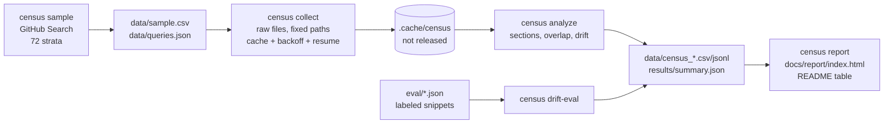

# agents-md-census

[](https://github.com/shreyas-tech7/agents-md-census/actions/workflows/ci.yml)

**Status:** v0.1.0-rc1. The dataset of 1,065 repos comes from one collection run in a cloud session on 2026-11-20. A larger run with more repos per stratum is a manual workflow that has not run yet.

## The problem

More and more repos ship a file of instructions for AI coding agents: `AGENTS.md`, `CLAUDE.md`, `.github/copilot-instructions.md`, `GEMINI.md`, `.cursorrules` or `SKILL.md`. Over 60,000 open-source projects use AGENTS.md (https://agents.md/). But nobody knows much about what these files hold, or whether they stay true. An agent that reads "run `npm run typecheck`" in a repo with no `typecheck` script wastes a turn, or worse, gives up on testing.

This repo measures two things across a stratified sample of public repos. First, what the files contain: their size, their sections and how much they repeat each other. Second, drift: how often a file names a script or target that the repo's own `package.json`, `Makefile` or `pyproject.toml` does not define. It releases the numbers as an open dataset with repo names and statistics only.

## How it works



## Results

The table below is written by `scripts/build_readme.py` from `results/summary.json` and `results/drift_eval.json`. A test fails if it drifts from those files. The full report, with breakdowns by language, star band and push year, is at [docs/report/index.html](docs/report/index.html). It opens from disk.

<!-- results:start -->
Sample: 1065 public repos collected on 2026-11-20, out of 1065 sampled. Intervals are 95% Wilson score intervals. Counts have no model and no seed. The sample seed is in `data/queries.json`.

| Measure | Result (95% CI) | k / n | Unit |
| --- | --- | --- | --- |
| Repos with at least one agent instruction file | 8.5% (6.9 to 10.3) | 90 / 1065 | repos |
| Repos with AGENTS.md | 6.0% (4.7 to 7.6) | 64 / 1065 | repos |
| Repos with CLAUDE.md | 4.9% (3.7 to 6.3) | 52 / 1065 | repos |
| Repos with .github/copilot-instructions.md | 0.9% (0.5 to 1.7) | 10 / 1065 | repos |
| Repos with GEMINI.md | 0.2% (0.1 to 0.7) | 2 / 1065 | repos |
| Repos with SKILL.md | 0.0% (0.0 to 0.4) | 0 / 1065 | repos |
| Repos with .cursorrules | 0.1% (0.0 to 0.5) | 1 / 1065 | repos |
| Repos that use two or more file formats | 37.8% (28.5 to 48.1) | 34 / 90 | repos with a file |
| Files that only point to another instruction file | 22.5% (16.1 to 30.4) | 29 / 129 | files |
| Files with a commands section | 66.0% (56.3 to 74.5) | 66 / 100 | non-pointer files |
| Files with a testing section | 53.0% (43.3 to 62.5) | 53 / 100 | non-pointer files |
| Files with a style section | 55.0% (45.2 to 64.4) | 55 / 100 | non-pointer files |
| Files with an architecture section | 53.0% (43.3 to 62.5) | 53 / 100 | non-pointer files |
| Files with a boundaries section | 35.0% (26.4 to 44.7) | 35 / 100 | non-pointer files |
| Files with at least one drifted command | 5.6% (1.5 to 18.1) | 2 / 36 | files with a checkable command |
| Checkable commands that drift | 3.5% (1.8 to 6.7) | 8 / 230 | checkable commands |
| Drift detector precision, 30 labeled snippets | 100.0% (74.1 to 100.0) | 11 / 11 | predicted drift |
| Drift detector recall, 30 labeled snippets | 91.7% (64.6 to 98.5) | 11 / 12 | labeled drift |
| Drift detector precision, 12 held-out snippets | 100.0% (67.6 to 100.0) | 8 / 8 | predicted drift |
| Drift detector recall, 12 held-out snippets | 72.7% (43.4 to 90.3) | 8 / 11 | labeled drift |
| Two blind labelers agree on a snippet | 96.7% (83.3 to 99.4) | 29 / 30 | snippets |

Cost of this run: 144 Search API requests, 7350 raw file requests (6.9 per repo), 0 model calls, $0. These are fixed counts.
<!-- results:end -->

## Cost per task

The census calls no model and costs nothing to run. The cost line under the results table gives the exact request counts. Collection is the slow part. The collector paces itself to stay inside GitHub's limits and slows to one request a second after any secondary limit, so the run of 1,065 repos took a few hours in the build session.

## Run it in 10 minutes

You need Python 3.11 or newer and git.

```bash
git clone https://github.com/shreyas-tech7/agents-md-census
cd agents-md-census
./init.sh                       # venv, install, lint, all tests offline
.venv/bin/census drift-eval     # score the drift detector on the labeled snippets
.venv/bin/census self-check     # run the detector on this repo's own AGENTS.md
```

To collect a small sample of your own (about 10 minutes at 3 repos per stratum):

```bash
.venv/bin/census sample --per-stratum 3 --data /tmp/census-data
.venv/bin/census collect --data /tmp/census-data
.venv/bin/census analyze --data /tmp/census-data --results /tmp/census-results
.venv/bin/census report --results /tmp/census-results --site /tmp/census-site
```

Set `GH_TOKEN` to a token that can only read public data to raise the Search limit. Never paste a token into a chat or commit it.

## Limits

The short version is below. Read [LIMITATIONS.md](LIMITATIONS.md) before you quote a number, and [METHODOLOGY.md](METHODOLOGY.md) for how each number is made.

- The sample gives each of 72 strata the same weight, so it over-represents popular repos. Numbers describe the sample, not all of GitHub.
- The collector reads nine fixed paths. It misses `.cursor/rules/` folders, nested `SKILL.md` files and files in subfolders.
- Drift checks root manifests only. It covers npm, pnpm, yarn and bun scripts, Make targets and poe tasks. Other ecosystems such as Cargo, Go, Gradle, just and `uv run` are not covered.
- The detector was scored on synthetic snippets. Real files are messier.
- The sample comes from one day.

## Glossary

- **Instruction file:** a file written for an AI coding agent, such as `AGENTS.md` or `CLAUDE.md`.
- **Stratum:** one cell of the sample design, for example "Go, 100 to 999 stars, last push in 2025".
- **Pointer file:** a tiny instruction file that only points to another one, often a symlink.
- **Checkable command:** a command whose script or target the root manifest can confirm or deny.
- **Drift:** a checkable command whose script or target the root manifest does not define.
- **Wilson interval:** a 95% confidence interval for a proportion that behaves well for small counts and for values near 0% or 100%.
- **Precision and recall:** of the drift the detector reports, the share that is real. Of the real drift, the share it finds.

## Related work

- Several tools score one repo for agent readiness: [agent-ready](https://github.com/EShener/agent-ready), Charter and the OpenHands readiness report. This repo studies the population instead and ranks no repo.
- An earlier study looked at the agent instruction files of 466 open-source projects (https://arxiv.org/html/2510.21413v3). This census uses a stratified sample and adds a drift measure.
- The AGENTS.md format itself: https://agents.md/.

## How this was built

AI agents wrote most of the code and docs under Shreyas's direction. An unattended Claude Code run followed the build prompt in [docs/build/BUILD_PROMPT.md](docs/build/BUILD_PROMPT.md). Its choices are in [DECISIONS.md](DECISIONS.md) and its blockers in [BLOCKERS.md](BLOCKERS.md).

Human checks, not done yet:

- A human read of the 30 drift labels and the 12 held-out labels.
- A human spot check of a few drift verdicts against real repos.
- A human review of the code and the report before the repo goes public.

This repo follows its own advice. Every command in [AGENTS.md](AGENTS.md) exists, and CI runs `census self-check` to prove it.

License: [MIT](LICENSE).
